# Déploiement de WordPress sur Kubernetes avec des manifests YAML


Déploiement complet d'une application WordPress + MySQL dans un cluster Kubernetes, **écrit à la main en manifests YAML, sans Helm**, sur un environnement de lab entièrement automatisé (Vagrant + VirtualBox + Minikube).

L'objectif est de comprendre, objet par objet, ce que génère un chart Helm : Secrets, Deployments, ReplicaSets, Services, PersistentVolume et PersistentVolumeClaim.

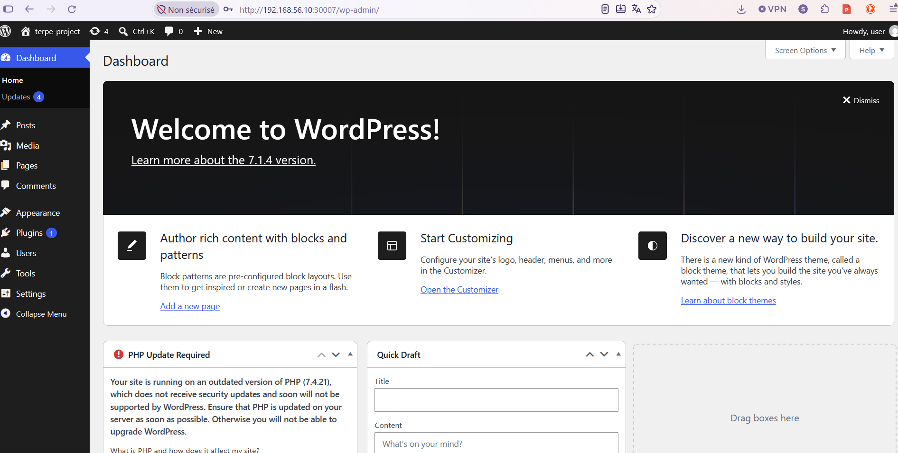

---

## Sommaire

- [Ce que démontre ce projet](#ce-que-démontre-ce-projet)
- [Architecture](#architecture)
- [Stack technique](#stack-technique)
- [Structure du dépôt](#structure-du-dépôt)
- [Démarrage rapide](#démarrage-rapide)
- [Déploiement pas à pas](#déploiement-pas-à-pas)
- [Environnements dev et prod avec Kustomize](#environnements-dev-et-prod-avec-kustomize)
- [Objets Kubernetes déployés](#objets-kubernetes-déployés)
- [Choix techniques](#choix-techniques)
- [Problèmes rencontrés et résolutions](#problèmes-rencontrés-et-résolutions)
- [Améliorations réalisées après les captures](#améliorations-réalisées-après-les-captures)
- [Pistes d'amélioration](#pistes-damélioration)
- [Nettoyage](#nettoyage)

---

## Ce que démontre ce projet

| Domaine | Compétences mises en œuvre |
|---|---|
| **Kubernetes** | Deployments, ReplicaSets, Services ClusterIP et NodePort, Secrets, PV/PVC, volumes hostPath, labels et selectors, ordre de déploiement |
| **Infrastructure as Code** | VM reproductible avec Vagrant, provisioning idempotent en Bash, Kustomize (base + overlays dev/prod, `secretGenerator`, patches JSON) |
| **Linux & virtualisation** | Diagnostic de modules noyau (Guest Additions VirtualBox), réseau privé, synchronisation rsync |
| **Troubleshooting** | Analyse de logs MySQL, tests de connectivité depuis un pod, résolution DNS interne, diagnostic de performances |

---

## Architecture

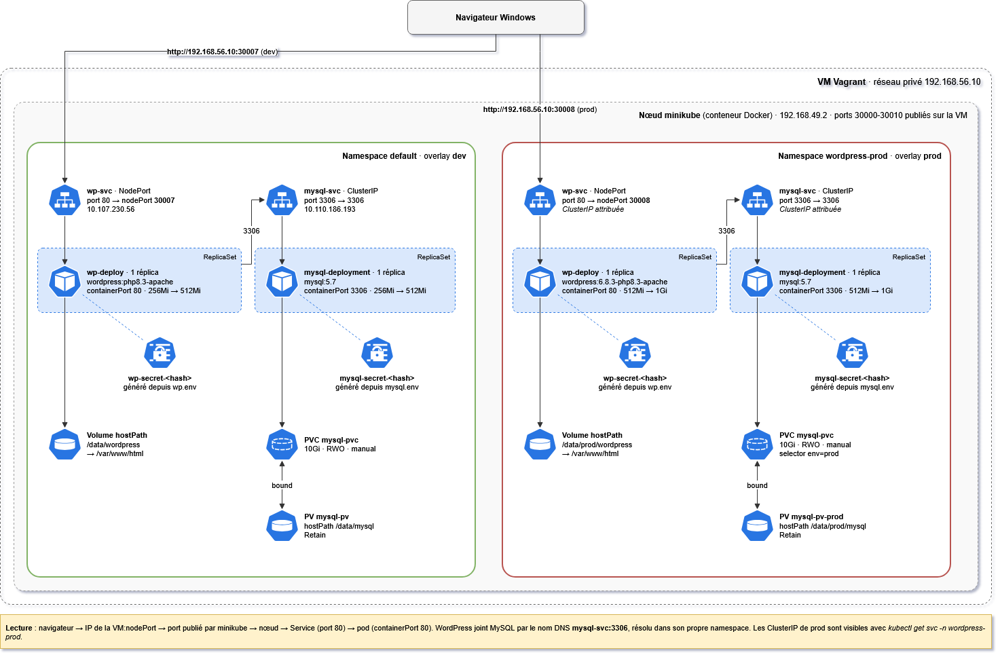

> Schéma source modifiable : [`docs/architecture.drawio`](docs/architecture.drawio) (à ouvrir sur [app.diagrams.net](https://app.diagrams.net)).

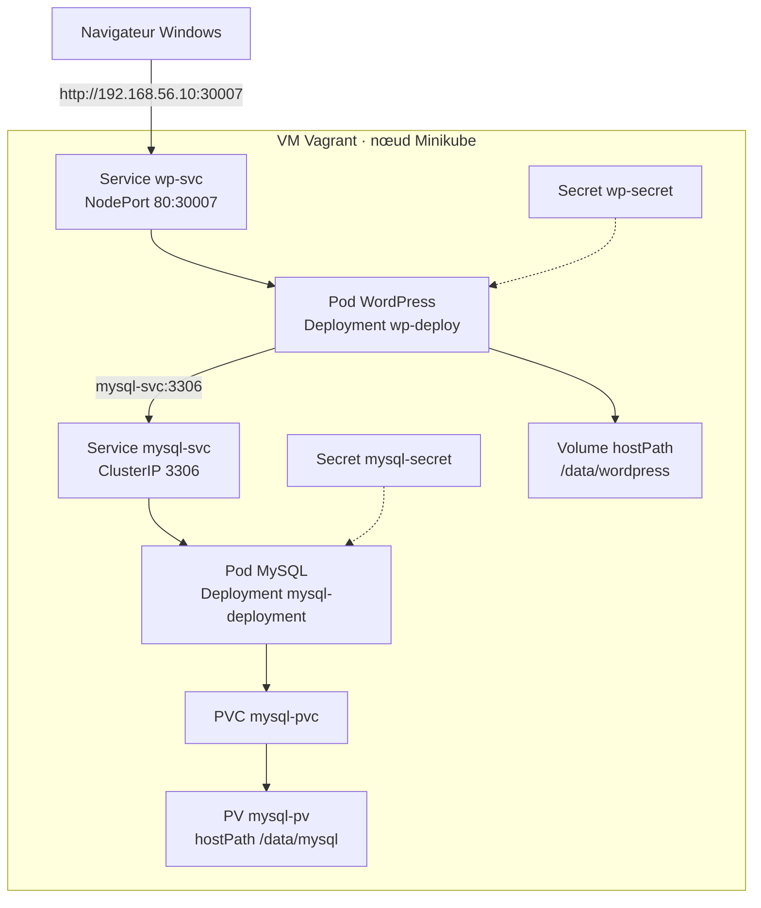

**Parcours d'une requête :**

1. Le navigateur appelle `192.168.56.10:30007` (IP privée de la VM, port publié par Minikube).
2. Le Service `wp-svc` (NodePort) transmet la requête au pod WordPress sur le port 80.
3. WordPress interroge MySQL via le nom DNS interne `mysql-svc`, résolu par le Service ClusterIP.
4. Chaque pod lit ses identifiants dans son Secret.
5. Les données MySQL sont stockées dans un PVC lié à un PV, celles de WordPress dans un volume `hostPath` : elles survivent à la recréation des pods.

---

## Stack technique

| Composant | Version | Rôle |
|---|---|---|
| VirtualBox | 7.2 | Hyperviseur |
| Vagrant | 2.4 | Création et provisioning de la VM |
| Rocky Linux 9 / Ubuntu 24.04 | box `bento` | Système de la VM (au choix dans le `Vagrantfile`) |
| Docker | CE | Runtime et driver de Minikube |
| Minikube | v1.37.0 | Cluster Kubernetes mono-nœud |
| Kubernetes / kubectl | v1.34.0 | Orchestration |
| MySQL | 5.7 | Base de données |
| WordPress | 7.1 (image `php8.3-apache`) | Application |

---

## Structure du dépôt

```
project-kubernetes/
├── README.md
├── Vagrantfile                 # VM : box, réseau, ressources, synchronisation rsync
├── install_minikube.sh         # Provisioning : Docker, Minikube, kubectl, services systemd
├── docs/
│   ├── architecture.drawio     # Schéma modifiable
│   ├── architecture.png        # Schéma affiché dans ce README
│   └── screenshots/            # Captures du déploiement (étapes 1 à 9)
└── k8s-manifest/
    ├── base/                          # Manifests communs, sans Secret
    │   ├── kustomization.yaml
    │   ├── mysql/                     # mysql-pv · mysql-pvc · mysql-deploy · mysql-svc
    │   └── wordpress/                 # wp-deploy · wp-svc
    └── overlays/
        ├── dev/                       # namespace default · NodePort 30007 · /data/*
        │   ├── kustomization.yaml
        │   ├── mysql.env.example      # Modèles des Secrets (les .env réels ne sont pas versionnés)
        │   └── wp.env.example
        └── prod/                      # namespace wordpress-prod · NodePort 30008 · /data/prod/*
            ├── kustomization.yaml     # image figée, ressources augmentées, patches
            ├── namespace.yml
            ├── mysql.env.example
            └── wp.env.example
```

Un fichier par objet Kubernetes dans `base/`. Chaque overlay ne contient que ce qui diffère de la base. Les Secrets sont générés par Kustomize à partir de fichiers `.env`, exclus de Git : seuls leurs modèles `.env.example` sont publiés.

---

## Démarrage rapide

### Prérequis

- Windows 10/11 avec VirtualBox 7.2 et Vagrant
- `rsync` dans le PATH Windows (via [Cygwin](https://www.cygwin.com/), paquets `rsync` et `openssh`)
- 8 Go de RAM libres pour la VM (ajustables dans le `Vagrantfile`)

### Lancement

```powershell
git clone https://github.com/mouandapeterson/project-kubernetes.git
cd project-kubernetes
vagrant up                 # crée la VM, installe Docker, Minikube et kubectl, démarre le cluster
vagrant rsync-auto         # dans un terminal dédié : synchronisation Windows -> VM
```

Créez les fichiers de Secrets de l'environnement à partir des modèles, puis renseignez vos mots de passe (identiques dans les deux fichiers). Enregistrez-les avec des fins de ligne **LF**, sinon le mot de passe contiendrait un caractère invisible :

```powershell
copy k8s-manifest\overlays\dev\mysql.env.example k8s-manifest\overlays\dev\mysql.env
copy k8s-manifest\overlays\dev\wp.env.example k8s-manifest\overlays\dev\wp.env
```

Puis, dans la VM :

```bash
cd ~/project-kubernetes/k8s-manifest
kubectl apply -k overlays/dev
kubectl get pods -w
```

Le déploiement détaillé, étape par étape et avec captures, est décrit ci-dessous.

---

## Déploiement pas à pas

> Ces captures ont été réalisées avec la première version du projet, déployée dossier par dossier avec `kubectl apply -f`. Le projet utilise désormais Kustomize (voir [la section suivante](#environnements-dev-et-prod-avec-kustomize)) : les objets et leur comportement sont identiques.

### Étape 1 · Déployer la couche base de données

```bash
cd ~/project-kubernetes/k8s-manifest/mysql
kubectl apply -f .
```

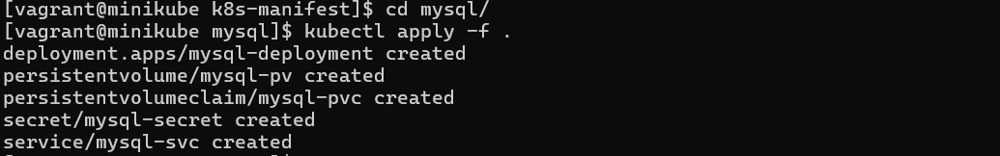

Une seule commande crée les cinq objets de la couche données :

- **`mysql-secret`** : mot de passe root, nom de la base, utilisateur et mot de passe applicatifs ;
- **`mysql-pv`** : le volume physique, un dossier `/data/mysql` sur le nœud ;
- **`mysql-pvc`** : la demande de stockage du pod, qui se lie au PV ;
- **`mysql-deployment`** : le pod MySQL, avec une seule réplique ;
- **`mysql-svc`** : le Service ClusterIP qui donne à MySQL un nom DNS stable dans le cluster.

La base est déployée **avant** WordPress : l'application a besoin d'une base disponible dès son démarrage.

### Étape 2 · Vérifier que MySQL est opérationnel

```bash
kubectl get pods
```

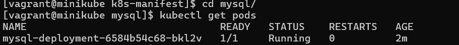

Le pod est `Running`, `1/1` conteneur prêt, sans redémarrage. Son nom suit la convention `<deployment>-<hash du ReplicaSet>-<suffixe aléatoire>` : il a été créé par un ReplicaSet, lui-même géré par le Deployment.

### Étape 3 · Déployer WordPress

```bash
cd ../wordpress
kubectl apply -f .
```

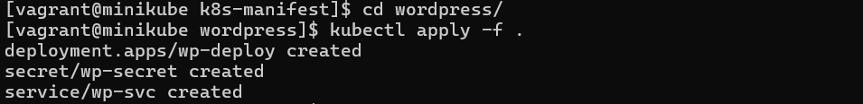

Trois objets sont créés : le Deployment **`wp-deploy`**, le Secret **`wp-secret`**, qui contient les variables de connexion à la base (`WORDPRESS_DB_*`), et le Service NodePort **`wp-svc`**, qui expose le site à l'extérieur du cluster.

### Étape 4 · Vérifier les deux pods

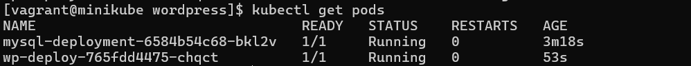

Les deux pods sont `Running`. L'écart d'âge (3 min contre 53 s) confirme l'ordre de déploiement : base de données d'abord, application ensuite.

### Étape 5 · Vue d'ensemble des ressources

```bash
kubectl get all
```

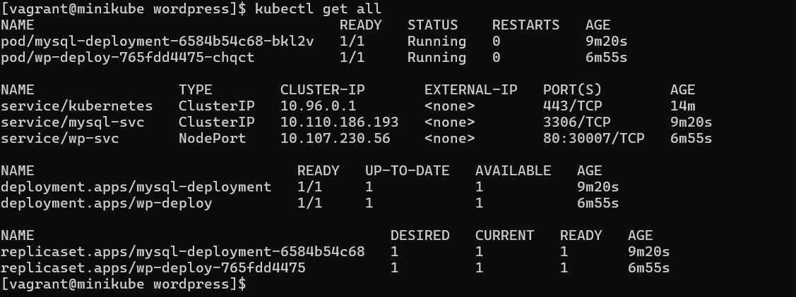

Cette vue montre la chaîne complète créée par Kubernetes à partir des manifests :

- **Services** : `mysql-svc` est en `ClusterIP` (`10.110.186.193:3306`), sans IP externe. La base n'est **joignable que depuis l'intérieur du cluster**. `wp-svc` est en `NodePort` et associe le port 80 du Service au port **30007** du nœud.
- **Deployments** : `1/1` disponible pour chacun, conformément à la consigne d'une seule réplique.
- **ReplicaSets** : créés automatiquement par les Deployments. Leur hash (`6584b54c68`, `765fdd4475`) se retrouve dans le nom des pods.

### Étape 6 · Vérifier le stockage persistant

```bash
kubectl get pv,pvc
```

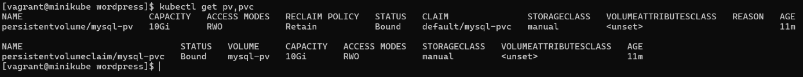

Le PV `mysql-pv` et le PVC `mysql-pvc` sont **`Bound`** (liés), en `ReadWriteOnce`, avec 10 Gi :

- **`storageClassName: manual`** force la liaison au PV déclaré, au lieu d'un volume créé automatiquement par la StorageClass par défaut de Minikube ;
- **`Retain`** garantit que la suppression du PVC n'efface pas les données de la base.

### Étape 7 · Contrôler la stabilité

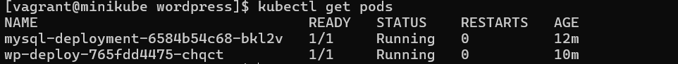

Après plus de 10 minutes de fonctionnement, aucun redémarrage (`RESTARTS 0`). Les pods sont stables et WordPress communique correctement avec MySQL.

### Étape 8 · Accéder à WordPress depuis Windows

Après l'assistant d'installation (choix de la langue, nom du site, compte administrateur), la page de connexion est accessible sur **http://192.168.56.10:30007/wp-login.php** :

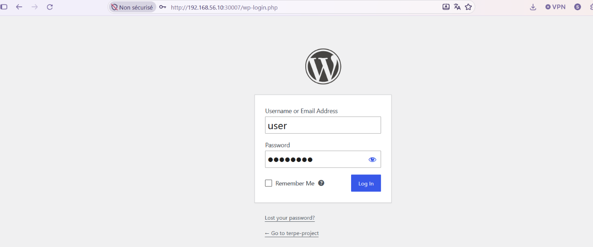

L'accès depuis le navigateur de l'hôte valide toute la chaîne réseau : réseau privé Vagrant, port publié par Minikube, Service NodePort, puis pod.

### Étape 9 · Tableau de bord opérationnel


Le tableau de bord confirme que le site est fonctionnel, et que le compte et la configuration sont bien enregistrés dans MySQL.

> **Point d'attention :** WordPress signalait une version de PHP obsolète (7.4), embarquée par l'image `wordpress:5.7.2-php7.4-apache` utilisée lors de ces captures. **Corrigé depuis** : `wp-deploy` utilise désormais `wordpress:php8.3-apache` (voir [améliorations réalisées](#améliorations-réalisées-après-les-captures)).

---

## Environnements dev et prod avec Kustomize

Le projet est organisé avec **Kustomize**, intégré à `kubectl` (`-k`) : une **base** commune et un **overlay** par environnement, qui ne décrit que ses différences.

| | `overlays/dev` | `overlays/prod` |
|---|---|---|
| Namespace | `default` | `wordpress-prod` |
| Image WordPress | `php8.3-apache` (suit les mises à jour) | `6.8.3-php8.3-apache` (version figée) |
| Ressources | requests 256Mi · limits 512Mi | requests 512Mi · limits 1Gi |
| Accès | `192.168.56.10:30007` | `192.168.56.10:30008` |
| Données | `/data/mysql`, `/data/wordpress` | `/data/prod/mysql`, `/data/prod/wordpress` |
| PV | `mysql-pv` | `mysql-pv-prod` (lié par selector `env=prod`) |

```bash
kubectl kustomize overlays/prod     # affiche le YAML final généré, sans rien appliquer
kubectl diff -k overlays/prod       # écarts avec le cluster
kubectl apply -k overlays/prod      # déploiement
```

**Points de conception :**

- **`secretGenerator`** crée les Secrets à partir des fichiers `.env` et ajoute un suffixe de hachage à leur nom (`mysql-secret-7g2k9f`). Les références des Deployments sont mises à jour automatiquement : modifier un mot de passe redémarre les pods, qui lisent ainsi la nouvelle valeur.
- **Labels communs avec `includeSelectors: false`** : les labels `project`, `managed-by` et `env` sont ajoutés à tous les objets sans modifier les selectors des Deployments, qui sont immuables.
- **Isolation des environnements** : un PersistentVolume n'appartient à aucun namespace. L'overlay prod lui donne donc un nom, un dossier et un label propres, et son PVC ne peut se lier qu'à lui. Sans cela, dev et prod partageraient la même base de données.
- **Patches JSON ciblés** pour les ressources, les chemins de données et le NodePort, sans dupliquer les manifests de la base.

## Objets Kubernetes déployés

| Objet | Type | Rôle |
|---|---|---|
| `mysql-secret-<hash>` | Secret (généré) | Mot de passe root (distinct), base, utilisateur et mot de passe applicatifs |
| `mysql-pv` | PersistentVolume | 10 Gi, `hostPath /data/mysql`, `Retain`, StorageClass `manual` |
| `mysql-pvc` | PersistentVolumeClaim | Demande de stockage liée à `mysql-pv` |
| `mysql-deployment` | Deployment | 1 réplique MySQL 5.7, `Recreate`, sondes, requests/limits, données sur le PVC |
| `mysql-svc` | Service ClusterIP | Accès interne sur le port 3306 |
| `wp-secret-<hash>` | Secret (généré) | Utilisateur, mot de passe et nom de la base pour WordPress |
| `wp-deploy` | Deployment | 1 réplique WordPress (PHP 8.3), `Recreate`, sondes, données sur `/data/wordpress` du nœud |
| `wp-svc` | Service NodePort | Exposition externe `80 → 30007` |

---

## Choix techniques

**Base de données non exposée.** `mysql-svc` est en ClusterIP : seuls les pods du cluster peuvent joindre MySQL. Seul WordPress est exposé, via un NodePort.

**Ordre de déploiement.** La couche données est appliquée et vérifiée avant l'application, pour que WordPress trouve une base prête à son démarrage.

**Stockage persistant maîtrisé.** StorageClass `manual` pour contrôler la liaison PV/PVC, et politique `Retain` pour protéger les données d'une suppression accidentelle.

**Ressources encadrées.** Chaque conteneur déclare des `requests` (ressources réservées pour le placement) et des `limits` (plafond), pour qu'un pod ne puisse pas monopoliser la VM.

**Port NodePort fixe.** `30007` se situe dans la plage `30000-30010` publiée par Minikube sur l'IP de la VM, ce qui rend le site accessible depuis Windows.

**Synchronisation rsync à sens unique.** Les manifests sont édités sous Windows et poussés vers la VM. Ce mode ne dépend pas des Guest Additions VirtualBox (voir le premier problème ci-dessous).

**Provisioning idempotent.** `install_minikube.sh` peut être relancé (`vagrant provision`) sans effet de bord. Toutes les versions sont centralisées en tête du `Vagrantfile`.

---

## Problèmes rencontrés et résolutions

### 1. Dossier partagé VirtualBox : `mount: No such device`

- **Symptôme :** Vagrant ne parvenait pas à monter le dossier projet (`vboxsf`).
- **Diagnostic :** le module noyau `vboxsf` était absent pour le noyau Rocky 9.8. La recompilation des Guest Additions échouait sur `implicit declaration of function 'from_timer'` : RHEL 9.8 a rétroporté le renommage de cette fonction, que les Guest Additions ne détectent pas.
- **Résolution :** abandon du dossier partagé VirtualBox au profit d'une synchronisation **rsync**, indépendante des Guest Additions et des futures mises à jour du noyau.

### 2. WordPress : « Error establishing a database connection »

- **Diagnostic, étape par étape :**
  1. MySQL était bien `ready for connections` : le problème se situait entre les deux applications.
  2. Un test de connexion depuis le pod WordPress renvoyait `Access denied for user 'wordpress'@'%' to database 'wordpress_db'` : le mot de passe était accepté, mais pas la base.
  3. Les logs de MySQL montraient qu'il réutilisait un dossier de données existant : les variables `MYSQL_*` ne sont lues qu'au **premier** démarrage, sur un dossier vide.
  4. Après réinitialisation, les logs ont révélé la cause racine : MySQL créait la base `wordpress`, alors que WordPress attendait `wordpress_db`.
- **Résolution :** réinitialisation du volume `/data/mysql` et alignement du nom de la base entre `mysql-secret` et `wp-secret`.

Commande de test utilisée, depuis le pod WordPress et avec ses propres variables :

```bash
kubectl exec deploy/wp-deploy -- php -r '
$h = explode(":", getenv("WORDPRESS_DB_HOST"));
$c = @new mysqli($h[0], getenv("WORDPRESS_DB_USER"), getenv("WORDPRESS_DB_PASSWORD"), getenv("WORDPRESS_DB_NAME"), $h[1] ?? 3306);
echo $c->connect_error ? "ERREUR : ".$c->connect_error."\n" : "Connexion OK\n";'
```

### 3. Lenteurs extrêmes de Docker

- **Symptôme :** `docker container inspect` dépassant 3 minutes, alertes MySQL `page_cleaner ... took 290408ms`.
- **Diagnostic :** VM privée de CPU et de disque par l'hôte (Hyper-V/VBS actifs sous Windows, mémoire de l'hôte saturée).
- **Résolution :** contournement avec `docker exec minikube …` pour les opérations urgentes, puis ajustement des ressources de la VM et de la configuration Windows.

---

## Améliorations réalisées après les captures

Une fois le déploiement validé, les manifests ont été revus pour corriger les faiblesses identifiées :

| Amélioration | Fichier | Pourquoi |
|---|---|---|
| Image **`wordpress:php8.3-apache`** au lieu de `5.7.2-php7.4-apache` | `wp-deploy.yml` | PHP 7.4 n'est plus maintenu (alerte de l'étape 9) |
| `WORDPRESS_DB_NAME` **lu dans `wp-secret`** au lieu d'être écrit en dur | `wp-deploy.yml` | Une valeur codée en dur est à l'origine du problème n° 2 |
| **Mot de passe root distinct** et suppression de `MYSQL_RANDOM_ROOT_PASSWORD` | `mysql-deploy.yml`, `mysql-secret.yml` | Root partageait le mot de passe applicatif, et la variable aléatoire rendait le vrai mot de passe root imprévisible |
| Sondes **readiness/liveness** | les deux Deployments | Un pod n'est déclaré prêt que s'il fonctionne réellement, et il est redémarré s'il se bloque |
| Stratégie **`Recreate`** | les deux Deployments | Avec un volume `ReadWriteOnce`, deux pods ne doivent jamais écrire en même temps dans le même dossier |
| Secrets générés par **`secretGenerator`** depuis des `.env` non versionnés | overlays | Plus de mots de passe dans des YAML, et redémarrage automatique des pods quand un secret change |
| Organisation **Kustomize** base + overlays dev/prod | `k8s-manifest/` | Deux environnements isolés sans dupliquer les manifests |
| `hostPath` en `DirectoryOrCreate` | `wp-deploy.yml` | Le dossier `/data/wordpress` est créé s'il n'existe pas |

## Pistes d'amélioration

- [ ] Fusionner `wp-secret` et `mysql-secret` en un **Secret unique**, lu par les deux Deployments, pour éliminer tout risque de décalage des identifiants
- [ ] Stocker les données WordPress dans un **PVC**, comme pour MySQL
- [ ] Remplacer le Deployment MySQL par un **StatefulSet** et migrer vers **MySQL 8.4 LTS** (MySQL 5.7 n'est plus maintenu depuis octobre 2023)
- [ ] Exposer WordPress via un **Ingress** avec TLS plutôt qu'un NodePort
- [ ] Ajouter des **NetworkPolicies** : seul WordPress peut joindre MySQL
- [ ] Gérer les Secrets avec **Sealed Secrets** ou **External Secrets**
- [ ] Empaqueter les manifests en **chart Helm**, puis comparer avec l'approche Kustomize et le chart officiel
- [ ] Ajouter une **CI GitHub Actions** de validation (`kubeconform`, `kube-linter`)

---

## Nettoyage

```bash
cd ~/project-kubernetes/k8s-manifest
kubectl delete -k overlays/prod      # supprime l'environnement prod (et son namespace)
kubectl delete -k overlays/dev       # supprime l'environnement dev
minikube ssh -- sudo rm -rf /data/mysql /data/wordpress /data/prod   # données (PV en Retain)
```

```powershell
vagrant destroy -f
```

---

## Auteur

**Peterson MOUANDA** · Ingénieur DevOps
 [LinkedIn](https://www.linkedin.com/in/peterson-mouanda/) · [GitHub](https://github.com/mouandapeterson)
